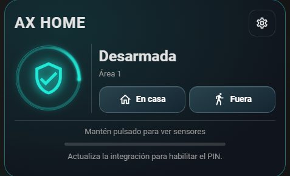
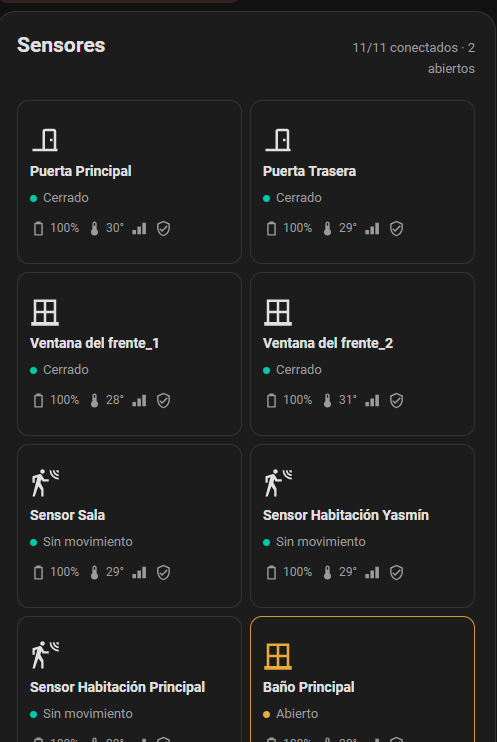

# AX HOME Cloud

<p align="center"></p>

Integración para Home Assistant para paneles AX HOME por medio de Hik-Connect. El repositorio reúne en una sola instalación HACS el cliente de nube, las entidades y las tarjetas Lovelace.

**Autor y mantenedor:** [YamPol02](https://github.com/YamPol02)

## Vista real de las tarjetas

Capturas de las tarjetas ejecutándose en Home Assistant. Los estados y nombres que aparecen son ejemplos de una instalación y pueden diferir de los tuyos.

### Seguridad AX HOME



La tarjeta muestra conexión y estado reportado por el panel. Mantén pulsada la tarjeta para navegar a la vista de sensores, si configuraste `hold_action`. Al elegir **En casa** o **Fuera**, primero revisa los sensores asignados a ese modo: si hay alguno abierto, muestra un aviso temporal y no abre el teclado ni envía la orden. Si todos están cerrados, solicita el PIN y envía la orden; después espera al estado confirmado por Hik-Connect.

### Sensores AX HOME



La cuadrícula adapta el número de columnas a la pantalla. Un toque en un sensor abre sus detalles; la tarjeta destaca aperturas y alertas disponibles (por ejemplo, sabotaje, batería baja o pérdida de conexión) y mantiene más discretos los estados normales. En la configuración se asignan sensores de forma independiente para **En casa** y **Fuera de casa**; un sensor puede pertenecer a ambos modos.

## Funciones

- Inicio de sesión propio en Hik-Connect; no requiere instalar la integración `hikconnect` de otra persona.
- Entidad `alarm_control_panel` con armado en casa, armado fuera, desarmado y consulta del estado que informa el panel.
- Sensores de zonas, con batería, sabotaje, señal, temperatura, conectividad y datos de zona cuando Hik-Connect los devuelve.
- PIN local verificado por Home Assistant antes de enviar comandos. El PIN no es la contraseña de Hik-Connect.
- Aviso de zonas abiertas separado por modo, selección de sensores por modo y detalles de sensor.
- Tarjetas de alarma y sensores servidas por la propia integración, sin Browser Mod ni recurso JS externo.
- Consulta periódica de zona con intervalo predeterminado de 1 segundo.

## Instalación con HACS

1. En HACS, añade `YamPol02/axhome-cloud` como repositorio personalizado de tipo **Integración**.
2. Descarga **AX HOME Cloud** y reinicia Home Assistant.
3. Ve a **Ajustes → Dispositivos y servicios → Añadir integración → AX HOME Cloud**.
4. Inicia sesión con tu cuenta Hik-Connect, elige el panel AX HOME, el área/subsistema y el tipo de cuenta. Para el propietario selecciona **Propietario**.
5. Elimina de `configuration.yaml` las entradas antiguas `platform: axhome_cloud` de alarma y sensor antes de migrar. La integración nueva crea esas entidades desde su entrada. No mantengas la integración Hik-Connect anterior para el mismo panel durante la prueba.
6. En **Ajustes → Paneles de control → Recursos**, elimina el recurso JS antiguo de AX HOME (`/local/axhome-cards*.js`). Recarga Home Assistant. La tarjeta se registra automáticamente; no agregues un recurso `/local/axhome-cards.js` manual.
7. En tu dashboard, usa las tarjetas de abajo y reemplaza `entity` por la entidad de alarma que aparece en **Dispositivos y servicios → AX HOME Cloud**.

La primera migración conserva el PIN local almacenado por Home Assistant y las asignaciones de zonas por modo, porque se mantienen los mismos identificadores de almacenamiento y de entidad. Haz una copia de seguridad antes de retirar la integración anterior. Conserva la configuración anterior hasta confirmar que la sesión nueva inicia y que Home Assistant recibe estado.

## Tarjetas

La tarjeta de seguridad conserva los tipos usados por las versiones entregadas durante este proyecto, incluido `axhome-security-fast-v35-card`:

```yaml
type: custom:axhome-security-fast-v35-card
entity: alarm_control_panel.ax_home_area_1
title: AX HOME
area_name: Área 1
hold_action:
  action: navigate
  navigation_path: /lovelace/alarma
```

Tarjeta de sensores:

```yaml
type: custom:axhome-sensors-card
title: AX HOME · Sensores
```

Los sensores se descubren por el número de zona en Hik-Connect. La selección de qué sensores pertenecen a cada modo se guarda en el almacenamiento privado de Home Assistant y requiere un usuario administrador y el PIN de AX HOME.

## Seguridad y limitaciones

- El usuario y la contraseña Hik-Connect se guardan dentro de la entrada de configuración de Home Assistant y solo se usan en el servidor. Nunca se incluyen en la tarjeta, YAML del dashboard o logs de diagnóstico.
- El cliente no crea ni cambia las credenciales de Hik-Connect. Si Hik-Connect solicita CAPTCHA, inicia sesión primero en su aplicación y luego vuelve a probar la configuración.
- El panel debe estar asociado a la cuenta que se usa en el flujo. La API cloud y sus permisos pueden cambiar sin aviso de Hikvision.
- El estado es el informado por la nube; las acciones se confirman consultando el estado y pueden tardar en reflejarse.
- El valor de encuesta de un segundo es configurable en el código actualmente y puede aumentar carga/consumo. Si Hik-Connect limita las consultas, se reducirá el intervalo en una versión siguiente.
- El envío y la recepción de órdenes no se consideran validados hasta probarlos en la instalación real. No se ejecuta armado/desarmado automáticamente durante instalación o diagnóstico.

## Cliente Hik-Connect incorporado

El cliente API está incluido bajo `custom_components/axhome_cloud/hikconnect/`. Deriva del proyecto de Tomas Bedrich y conserva sus avisos MIT y enlaces de origen en [THIRD_PARTY_NOTICES.md](THIRD_PARTY_NOTICES.md). Su autoría no se atribuye a YamPol02.

## Firmas

YamPol02 figura como mantenedor en los metadatos. Los commits y etiquetas se firman con la clave SSH del mantenedor; el cliente Hik-Connect integrado conserva la atribución y licencia MIT de su autor original.

## Desarrollo y diagnóstico

El servicio `axhome_cloud.diagnose` es de solo lectura. Incluye respuestas resumidas de estado y zona; revisa y redacta cualquier dato antes de compartir el resultado. Para revisar errores, filtra el registro por `custom_components.axhome_cloud`.
